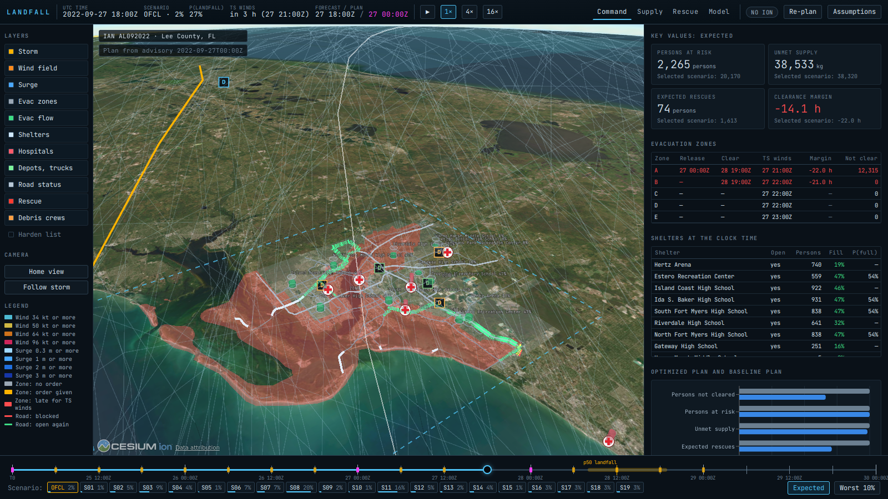

# LANDFALL

LANDFALL predicts the track and the intensity of a hurricane as a Monte Carlo ensemble. It converts each scenario into wind, surge, damage, and road impacts on one county. Then it plans the evacuation, the supplies, search and rescue, and debris clearing, and it shows the result on a 3D globe with a timeline.

The demo replays Hurricane Ian (AL092022) over Lee County, Florida, from 2022-09-25 00:00 UTC to 2022-09-30 00:00 UTC.

## Quick start

1. Copy `.env.example` to `.env`.
2. Optional: set `CESIUM_ION_TOKEN` in `.env` for Google Photorealistic 3D Tiles.
3. Run `make demo`.
4. Open `http://localhost:5173`.

`make demo` installs the dependencies, downloads the data, trains the model, runs all stages, and starts the API and the UI. The first run takes about 25 min on a 12-core CPU. Later runs use the cache.

To use the in-process Chalk runtime, run `CHALK_MODE=local make demo`.

## Requirements

- Python 3.12 and `uv`. The Makefile installs `uv` if necessary.
- Node.js 20 or newer. The Makefile loads `nvm` if `node` is not on the PATH.
- About 2 GB of disk space for the data cache.

A GPU is not necessary. The model trains on the CPU in about 6 min.

## Commands

| Command | Result |
| --- | --- |
| `make install` | Install the Python and web dependencies. |
| `make data` | Download and cache every data source. |
| `make train` | Build the Chalk training frame and train the predictor. |
| `make precompute` | Run Stage 1 to Stage 3 and write `out/`. Set `FORCE=1` to compute again. |
| `make serve` | Start the API on port 8000 and the UI on port 5173. |
| `make check` | Run ruff, pytest, tsc, eslint, and the STE linter. |

## Data and assumptions

| Item | Source or value |
| --- | --- |
| Best track and training data | NHC HURDAT2, Atlantic storms from 1980 to 2021 |
| Replay input | ATCF a-deck of Ian: CARQ fixes and the OFCL forecast |
| Evacuation zones | Lee County GIS, zones A to E |
| Population | Census TIGER 2022 block groups and ACS 5-year 2022 tables |
| Elevation | Copernicus GLO-30 DEM |
| Roads | OpenStreetMap through OSMnx |
| Shelters, hospitals, depots, SAR assets | Curated files in `data/static/`. The capacities are assumptions. |
| Wind | Holland (1980) profile with B = 1.3. Rmax is 35 km for Category 3 and higher, and 50 km for weaker storms. |
| Surge | A proxy, not SLOSH. The constant is calibrated to give 4 m (13 ft) at Fort Myers Beach for the Ian truth track. |
| Evacuation | 70% compliance (55% to 85% in each draw), 15% shadow evacuation, departures over 12 h |
| Damage | The chance of major damage is 50% at a gust of 95 mph (42 m/s). 2% of the persons in a damaged building get an injury. |
| Rescue | 30% of the persons that stay in water deeper than 1 m ask for rescue. |

`docs/MODEL_CARD.md` gives every assumption and the verification results. The UI shows the same values in the "Assumptions" drawer.

## Documentation

- `docs/ARCHITECTURE.md`: the parts of the system and the reason for Chalk.
- `docs/DATA_SOURCES.md`: each data file, its origin, and its licence.
- `docs/MODEL_CARD.md`: the model, the assumptions, and the verification numbers.
- `docs/DECISIONS.md`: the decisions that the build prompt did not fix.
- `docs/RUNBOOK.md`: the operation procedures and the acceptance results.
- `docs/STE_RULES.md`: the writing rules for the documentation.

WARNING: LANDFALL is a demonstration. Do not use it for operational emergency decisions.

## Licence

MIT. See `LICENSE`.
